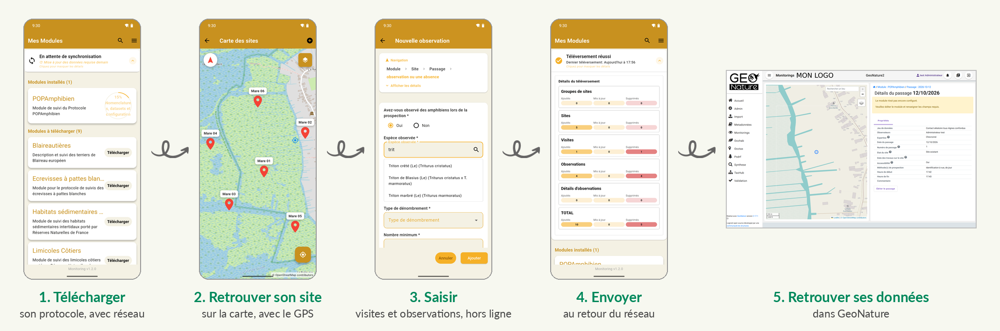
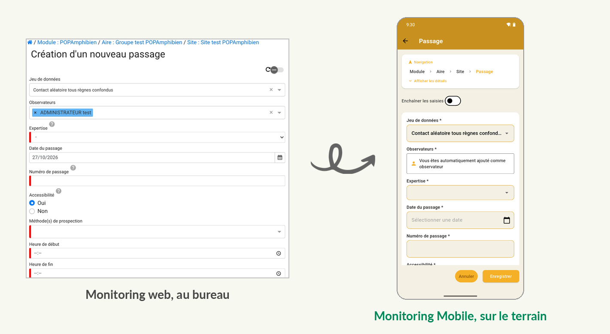
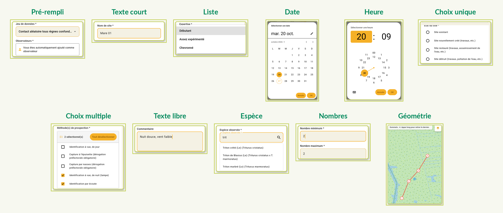

# Monitoring Mobile

**Vos protocoles de suivi GeoNature, sur le terrain, même sans réseau.**

Monitoring Mobile est l'application Android du module Monitoring de GeoNature.

- **Hors connexion** : modules, listes, taxons et sites sont téléchargés sur le téléphone ; toute la saisie se fait sans réseau
- **Envoi différé** : on saisit sur le terrain, on envoie plus tard, au retour du réseau, avec un bilan par type d'objet (sites, visites, observations)
- **Mêmes protocoles que le web** : les formulaires sont construits depuis la configuration du module Monitoring, sans développement par protocole
- **Carte et GPS** : retrouver ses sites, tracer points, lignes et polygones
- **Saisie enchaînée** : plusieurs observations à la suite, sans revenir en arrière
- **Mises à jour automatiques** : l'appli propose la nouvelle version déposée sur votre serveur GeoNature

[**Télécharger la dernière version (APK)**](../../releases/latest)



## 🔁 Une configuration, deux outils

Le même fichier de configuration donne le formulaire web et le formulaire mobile. Les règles du protocole (champs masqués selon les réponses, valeurs recopiées d'un champ à l'autre) s'appliquent aussi hors ligne.



## 🧩 Les types de champs



Le détail des widgets et des limites est dans la [vue d'ensemble des fonctionnalités](./docs/FEATURES_OVERVIEW.md).

## ✅ Fiabilité : tests et protocoles

**Les règles des protocoles se comportent comme sur le web.** Les 104 expressions des protocoles de [protocoles_suivi](https://github.com/PnX-SI/protocoles_suivi) (champs masqués ou rendus obligatoires selon les réponses) sont rejouées sur 1 330 cas et comparées au résultat du moteur JavaScript du module web ([`test/fixtures/js_expressions_corpus.json`](./test/fixtures/js_expressions_corpus.json)).

| Niveau | Quand | Ce qui est vérifié |
|---|---|---|
| 1 700 tests unitaires et de widgets | à chaque push et pull request vers `develop` et `main` | formulaires, règles, stockage local, synchronisation |
| 54 scénarios E2E sur émulateur Android, serveur simulé | idem (50 scénarios, sans ceux de la carte) | parcours complets avec des extraits réels de 7 protocoles |
| 17 scénarios E2E contre un vrai GeoNature (Docker) | chaque lundi et avant une release | connexion, téléchargement, saisie, envoi, sur POPAmphibien et POPReptile |
| Aller-retour complet sur 6 protocoles | à chaque version | téléchargement, saisie, envoi, puis contrôle des données sur le serveur : POPAmphibien, POPReptile, STOM, Nidification du Gypaète barbu, Écrevisses à pattes blanches, Blaireautières |

**Couverture des protocoles.** Sur les 37 protocoles analysés, 30 se saisissent entièrement, 5 avec réserves (liste d'habitats vide, déterminateur imposé) et 2 ne peuvent pas encore être saisis (CMR Cistude, Pelotes de réjection). Deux limites touchent presque tous les protocoles : pas d'ajout de photos (#232) et un seul observateur, l'utilisateur connecté (#230). Le détail, protocole par protocole, est dans [la compatibilité des modules](./docs/MODULES_COMPATIBILITY.md).

## Compatibilité des versions

| Version app mobile | GeoNature core | Monitoring serveur (min) | Code de version (à saisir côté admin GeoNature) |
|---|---|---|---|
| `v1.2.0-geonature-2.17-2.18` | 2.17.x et refonte monitoring (2.18) | ≥ 1.2.6 | `4` |
| `v1.1.1-geonature-2.17` | 2.17.x | ≥ 1.2.6 | `3` |
| `v1.1.0-geonature-2.17` | 2.17.x | ≥ 1.2.6 | `2` |
| `v1.0.0-geonature-2.17` | 2.17.x | 1.2.6 | `1` |

Le **code de version** est la valeur à renseigner côté admin GeoNature (voir [Déploiement](#-déploiement-et-mise-à-jour)). Pour l'historique complet des releases, voir [`docs/VERSIONS.md`](./docs/VERSIONS.md).

L'application vérifie automatiquement la version du module Monitoring sur le serveur GeoNature avant chaque téléchargement de module. Si la version est inférieure à la version minimale requise, le téléchargement est bloqué avec un message explicatif.

Chaque ligne majeure GeoNature a sa propre branche de support : `support/geonature-2.17` et `support/geonature-2.16` pour les hotfixes. Le développement courant sur `develop` cible la prochaine compat.

## 📋 Prérequis

- Android 5.0 minimum
- GeoNature 2.16.x ou 2.17.x avec le module Monitoring correspondant (voir matrice ci-dessus)
- Compte utilisateur avec droits sur les modules

## 🚀 Installation

### Application Android (bêta)
Téléchargez la dernière version APK depuis les [Releases](../../releases).

### Depuis les sources
```bash
# Cloner le repository
git clone https://github.com/RNF-SI/gn_mobile_monitoring/
cd gn_mobile_monitoring

# Installer les dépendances
flutter pub get

# Générer le code
flutter pub run build_runner build --delete-conflicting-outputs

# Lancer l'application
flutter run
```

## ⚙️ Configuration

1. Lancer l'application
2. Saisir l'URL de votre instance GeoNature
3. Se connecter avec ses identifiants GeoNature
4. Télécharger les modules de Monitoring souhaités

## 🛠️ Développement

L'application utilise Flutter 3.47.7 (Dart 3.13.5) et suit une architecture Clean Architecture. Voir [CURSORRULES.md](./CURSORRULES.md) pour les conventions de code.

### Documentation
- [Vue d'ensemble des fonctionnalités](./docs/FEATURES_OVERVIEW.md) — types de widgets, compatibilité des modules et limitations
- [Compatibilité des modules](./docs/MODULES_COMPATIBILITY.md) — état de chaque protocole de suivi (configuration, tests automatisés, retours terrain)
- [Expressions JavaScript supportées](./docs/JAVASCRIPT_EXPRESSIONS.md) — documentation technique des expressions JS
- [Tâches](./TASKS.md)
- [Snippets](./SNIPPETS.md)
- [.cursorrules](./CURSORRULES.md)
- [Fichiers de Prompts](./PROMPTS.md)

## 🧪 Tests

### Tests unitaires
```bash
make test              # Exécute les tests unitaires
make test-unit         # Alias pour les tests unitaires
```

### Tests d'intégration
Les tests d'intégration vérifient l'interaction avec les API réelles de GeoNature.

#### Configuration
1. Copier le fichier de configuration : `cp .env.test.example .env.test`
2. Configurer avec des identifiants réels (déjà configuré pour POPAmphibien/POPReptile)

#### Exécution
```bash
make test-integration              # Tests d'intégration avec vraies requêtes HTTP
make test-integration-manual       # Validation rapide de la configuration
```

Pour plus de détails, voir [la documentation des tests d'intégration](./test/integration/README.md).

#### Tests E2E contre un vrai serveur GeoNature
Tests qui pilotent l'app sur un téléphone Android contre une vraie API GeoNature
(login, navigation module, CRUD sites/visites/observations).

```bash
.github/geonature-e2e/up.sh                  # GeoNature de test en Docker, port 5000
.github/geonature-e2e/run_scenarios.sh POPAmphibien,POPReptile POPReptile
./run_real_e2e_tests.sh --device=<id> auth   # ou un seul scénario : auth | module | sites | visits | …
```

Voir [la documentation des tests E2E réels](./docs/E2E_REAL_API_TESTS.md) pour la
configuration, la procédure après reboot et le troubleshooting.

## 🔄 CI/CD

Le projet utilise GitHub Actions pour l'intégration continue, sur chaque push
et chaque pull request vers `develop` et `main` :
- `flutter_tests.yml` : analyse statique (`flutter analyze`) et tests unitaires
  et de widgets, avec la couverture envoyée à Codecov
- `e2e_tests.yml` : scénarios E2E simulés (`integration_test/scenarios/`) sur
  un émulateur Android

Les scénarios contre un vrai serveur GeoNature (`integration_test/scenarios_real/`)
tournent dans `e2e_real_tests.yml` chaque lundi, ou à la main avant une release,
contre un GeoNature monté en Docker. Les tests d'intégration HTTP
(`test/integration/`) se lancent en local (voir plus haut).

## 🧾 SBOM et Dependency-Track

Le script `scripts/generate-sbom.sh` produit un SBOM CycloneDX 1.6 (JSON) des
dépendances Dart/Flutter dans `sbom/`. Le graphe vient de `flutter pub deps`,
et les empreintes SHA-256 viennent de `pubspec.lock`. L'outillage Python est
installé dans un venv local, `.sbom-tools/`. Les dépendances natives Android
(Gradle) ne sont pas couvertes.

Le workflow [.github/workflows/sbom.yml](.github/workflows/sbom.yml) le lance
à chaque release publiée (ou manuellement). Il envoie le SBOM dans
Dependency-Track et le conserve comme artefact du workflow. Il utilise les
secrets `DT_URL` et `DT_API_KEY`.

Génération manuelle :

```bash
flutter pub get
scripts/generate-sbom.sh               # dépendances de production uniquement
scripts/generate-sbom.sh --avec-dev    # + dev_dependencies (build_runner, mockito…)

# Envoi vers Dependency-Track (projet gn_mobile_monitoring-dart)
DT_URL=https://dependencytrack.reserves-naturelles.org DT_API_KEY=… \
  scripts/generate-sbom.sh --envoi
```

Le script utilise deux notions de version distinctes :

- **`DT_VERSION`** (défaut `prod`) : la version du *projet* dans
  Dependency-Track, qui représente l'environnement. Elle reste fixe :
  chaque envoi remplace le SBOM de `gn_mobile_monitoring-dart@prod`, sans
  créer un nouveau projet à chaque release.
- **`APP_VERSION`** : la version applicative inscrite dans le SBOM
  (composant racine). En CI, c'est le tag de la release. Par défaut, c'est
  le champ `version` du `pubspec.yaml`.

Autres variables : `DT_PROJET`, le préfixe des projets (défaut : nom du dépôt).

## 📦 Déploiement et mise à jour

### Publier une nouvelle version

1. Compiler l'APK : `flutter build apk --release`
2. Créer une release sur GitHub avec l'APK en pièce jointe

### Configurer le serveur GeoNature

Pour que les utilisateurs soient notifiés des mises à jour, l'administrateur du serveur GeoNature doit :

1. **Créer le dossier et le fichier de configuration** :
   ```bash
   mkdir -p <GEONATURE>/backend/media/mobile/monitoring/
   echo '{}' > <GEONATURE>/backend/media/mobile/monitoring/settings.json
   ```

2. **Déposer l'APK** (téléchargé depuis les releases GitHub) :
   ```bash
   cp monitoring-v<X.Y.Z>-geonature-<M.m>.apk <GEONATURE>/backend/media/mobile/monitoring/monitoring.apk
   ```

   > ⚠️ **Le nom du fichier sur le serveur doit correspondre EXACTEMENT au champ « Chemin relatif » de l'admin** (étape 3). L'app construit l'URL de téléchargement directement à partir de ce chemin — un nom différent → 404 → la mise à jour reste bloquée en chargement chez l'utilisateur.
   >
   > La convention est de renommer en `monitoring.apk` (URL stable d'une release à l'autre, le chemin admin ne change jamais — seul le **Code de version** est à incrémenter à chaque release).

3. **Enregistrer l'application** dans l'admin GeoNature :
   - Aller dans **Administration > Autres > Applications mobiles**
   - Créer une entrée avec :

   | Champ | Valeur |
   |-------|--------|
   | Code application | `MONITORING` |
   | Chemin relatif de l'APK | `monitoring/monitoring.apk` |
   | Nom du paquet | `org.reserves_naturelles.monitoring` (depuis la v1.2.0) |
   | Code de version | Valeur publiée avec chaque release — voir le tableau [Compatibilité des versions](#compatibilité-des-versions) ou [`docs/VERSIONS.md`](./docs/VERSIONS.md). Pour la release `v1.2.0`, c'est `4`. |

   > ⚠️ **Code de version** : ne pas confondre avec le nom de version (`1.0.0`). C'est un entier strictement croissant, fixé à la compilation (buildNumber de `pubspec.yaml`), que l'admin doit saisir tel quel. L'app ne propose une mise à jour que si la valeur admin est **strictement supérieure** à celle de l'APK installé.

4. **Mettre à jour** : lors d'une nouvelle version, **remplacer le fichier `monitoring.apk`** sur le serveur (en renommant le nouvel APK téléchargé) et incrémenter le **Code de version** dans l'admin. Le chemin relatif reste inchangé.

L'application vérifie automatiquement au lancement et après chaque synchronisation si une mise à jour est disponible.

## 🤝 Contribution

Les contributions sont bienvenues ! N'hésitez pas à ouvrir une issue ou proposer une PR.

## 🐛 Support

Pour tout problème ou question, ouvrir une issue sur ce repository.

---

## 🇪🇺 Financement


> **Cofinancé par l’Union européenne. Les points de vue et les opinions exprimés sont toutefois ceux des auteurs et ne reflètent pas nécessairement ceux de l’Union européenne ou de CINEA. Ni l’Union européenne ni l’autorité chargée de l’octroi de la subvention ne peuvent en être tenues pour responsables.**

Réalisé dans le cadre du projet LIFE BIODIV’FRANCE<br>
Coordonné par l’Office Français de la Biodiversité, ce projet rassemble un consortium de 31 participants. Il accompagne la mise en œuvre de la stratégie nationale pour la biodiversité en travaillant sur 5 cibles : les territoires, aires protégées, filières, citoyens et acteurs de la formation.

---
